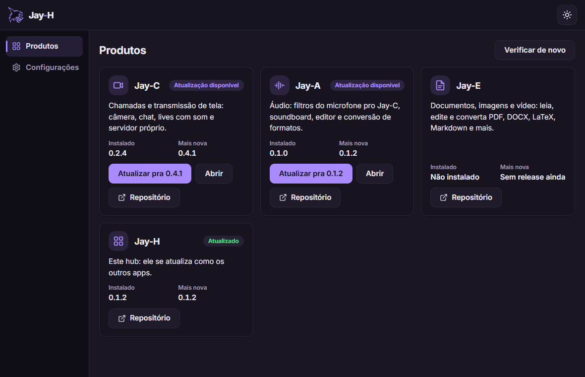
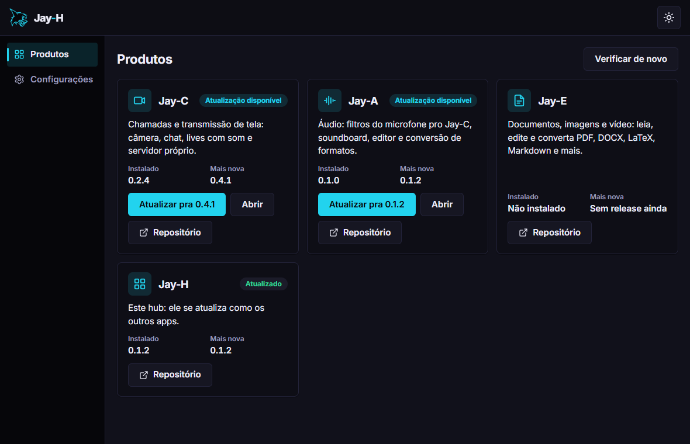
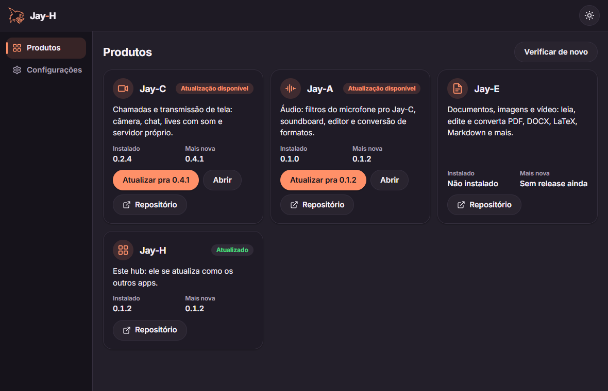

# Jay-H

**English** · [Português](README.pt-BR.md)

[](https://github.com/TyxMatty/Jay-H/actions/workflows/ci.yml)

The hub of the Jay line: one light, open-source app that gathers every Jay app ([Jay-C](https://github.com/TyxMatty/Jay-C), [Jay-A](https://github.com/TyxMatty/Jay-A), [Jay-E](https://github.com/TyxMatty/Jay-E), [Jay-S](https://github.com/TyxMatty/Jay-S)) in one place, to install, update and open them.

<p align="center"></p>

- **Every Jay app in one window**, with the installed version and the latest one on GitHub.
- **Install and update with one click**: the installer only runs if its SHA-256 matches GitHub's.
- **Updates itself**, from its own card, like the other apps.
- **The Jay line's look**: the Calm, Neon and Soft styles, light and dark, in English and Portuguese.

<table>
  <tr>
    <td></td>
    <td></td>
    <td></td>
  </tr>
  <tr align="center"><td>Calm</td><td>Neon</td><td>Soft</td></tr>
</table>

## Download

The Windows installer is in the **[releases](https://github.com/TyxMatty/Jay-H/releases/latest)**: download `Jay-H_<version>_x64-setup.exe` from the latest one. It installs for your user only, without asking for administrator. After that, Jay-H updates itself from its own card. Every version is listed under [releases](https://github.com/TyxMatty/Jay-H/releases).

## Code

| Folder | Contents |
|---|---|
| [`frontend/`](frontend/) | Tauri v2 + vanilla JS app (Vite) |
| [`frontend/src/core/products.json`](frontend/src/core/products.json) | The catalog: a new Jay app is a new entry here |
| [`frontend/src-tauri/`](frontend/src-tauri/) | The Rust side: installed versions (Windows registry), download, SHA-256 and installer, taskbar icon |
| [`docs/ARQUITETURA.en.md`](docs/ARQUITETURA.en.md) | Architecture, technical decisions, stages and how to release a version |
| [`.github/workflows/`](.github/workflows/) | CI: tests on every push, and the installer on a version tag |

## Running the app

```bash
npm install
npm run dev
```

This opens the Jay-H window (Tauri) with hot reload. To open only the interface in a browser, without Tauri, use `npm run web` (port 5176). The first Rust build takes a few minutes. It needs Node 22+ and Rust with MSVC (see Jay-C's `docs/CONTINUAR.en.md`).

`npm run build` makes the Windows installer (NSIS) under `release/bundle/nsis/` in the Cargo target folder. To keep the Rust build out of OneDrive, create a `.cargo/config.toml` (not tracked by git):

```toml
[build]
target-dir = "C:/Users/<you>/.cargo-target/jay-h"
```

## Tests

```bash
npm test
cd frontend/src-tauri && cargo test               # add -- --ignored to download Jay-C's real installer (not run)
```
