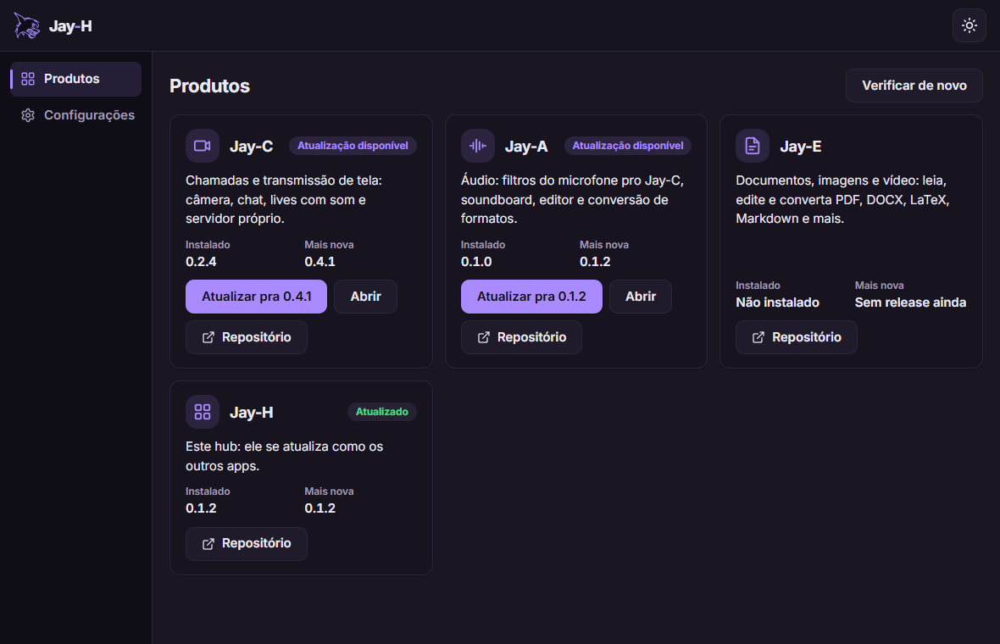
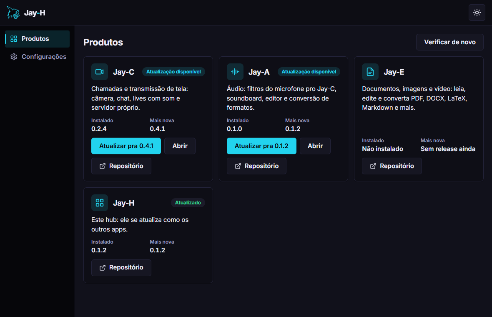
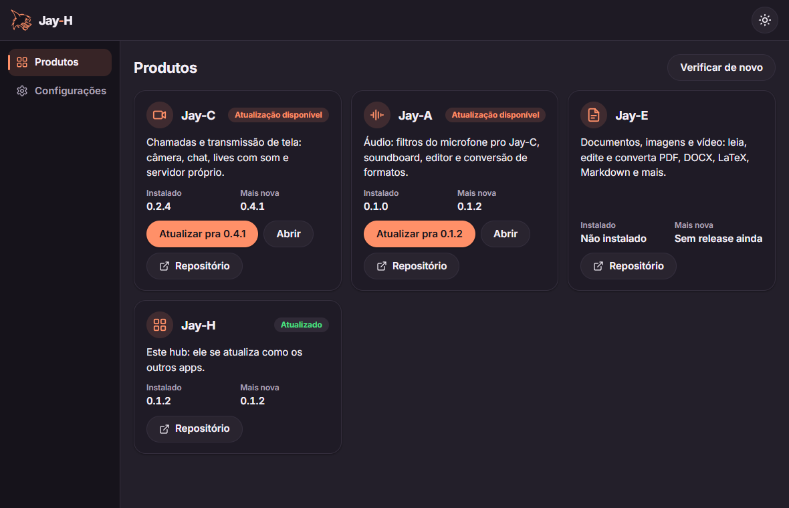

# Jay-H

[English](README.md) · **Português**

[](https://github.com/TyxMatty/Jay-H/actions/workflows/ci.yml)

O hub da linha Jay: um app leve e open-source que reúne todos os apps Jay ([Jay-C](https://github.com/TyxMatty/Jay-C), [Jay-A](https://github.com/TyxMatty/Jay-A), [Jay-E](https://github.com/TyxMatty/Jay-E)) num lugar só, para instalar, atualizar e abrir.

<p align="center"></p>

- **Todos os apps Jay numa janela**, com a versão instalada e a mais nova no GitHub.
- **Instalar e atualizar com um clique**: o instalador só roda se o SHA-256 bater com o do GitHub.
- **Se atualiza sozinho**, pelo próprio card, como os outros apps.
- **A cara da linha Jay**: os estilos Calmo, Neon e Suave, claro e escuro, em português e inglês.

<table>
  <tr>
    <td></td>
    <td></td>
    <td></td>
  </tr>
  <tr align="center"><td>Calmo</td><td>Neon</td><td>Suave</td></tr>
</table>

## Baixar

O instalador para Windows está nos **[releases](https://github.com/TyxMatty/Jay-H/releases/latest)**: baixe o `Jay-H_<versão>_x64-setup.exe` da versão mais recente. Ele instala só para o seu usuário, sem pedir administrador. Depois disso, o Jay-H se atualiza pelo próprio card. Todas as versões ficam em [releases](https://github.com/TyxMatty/Jay-H/releases).

## Código

| Pasta | Conteúdo |
|---|---|
| [`frontend/`](frontend/) | App em Tauri v2 + JS puro (Vite) |
| [`frontend/src/core/products.json`](frontend/src/core/products.json) | O catálogo: um app Jay novo é uma entrada nova aqui |
| [`frontend/src-tauri/`](frontend/src-tauri/) | O lado Rust: versões instaladas (registro do Windows), download, SHA-256 e instalador, ícone da barra de tarefas |
| [`docs/ARQUITETURA.md`](docs/ARQUITETURA.md) | Arquitetura, decisões técnicas, etapas e como lançar uma versão |
| [`.github/workflows/`](.github/workflows/) | CI: testes a cada push, e o instalador numa tag de versão |

## Rodando o app

```bash
npm install
npm run dev
```

Isso abre a janela do Jay-H (Tauri) com recarga automática. Para abrir só a interface no navegador, sem Tauri, use `npm run web` (porta 5176). O primeiro build do Rust leva alguns minutos. Precisa de Node 22+ e Rust com MSVC (ver `docs/CONTINUAR.md` do Jay-C).

`npm run build` gera o instalador do Windows (NSIS) em `release/bundle/nsis/`, na pasta do target do Cargo. Para o build do Rust ficar fora do OneDrive, crie um `.cargo/config.toml` (fora do git):

```toml
[build]
target-dir = "C:/Users/<você>/.cargo-target/jay-h"
```

## Testes

```bash
npm test
cd frontend/src-tauri && cargo test               # com -- --ignored, baixa o instalador real do Jay-C (sem rodar)
```
