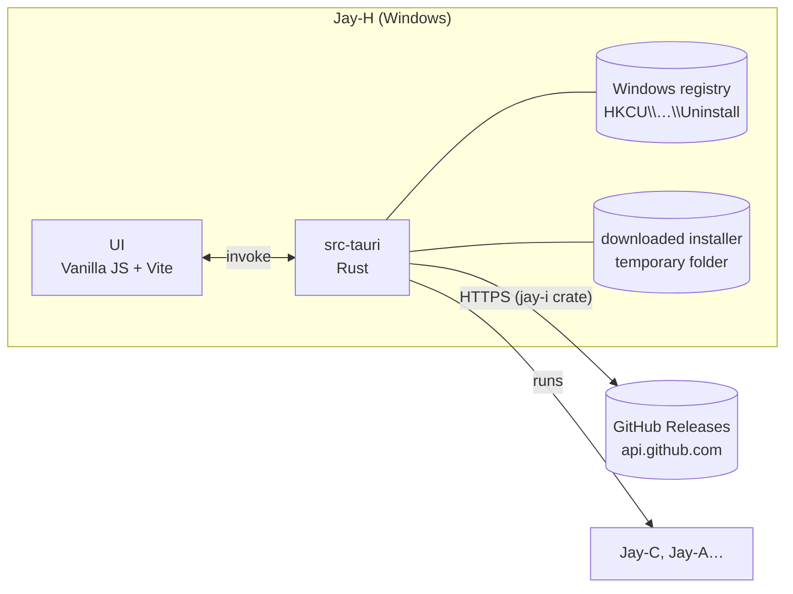

# Jay-H — Architecture

[Português](ARQUITETURA.md) · **English**

The hub of the Jay line: one app that gathers every Jay product (today **Jay-C**, **Jay-A**, **Jay-E**, **Jay-S** and Jay-H itself), shows the installed and the latest version of each one, and installs, updates and opens them. Windows first, like the others.

Written on 2026-11-06, starting from Jay-A 0.1.0 and Jay-C 0.4.0. License: **MIT**, like the whole line.

## 1. Overview

- In a browser (`npm run web`), the page neither reads the registry nor asks GitHub: the card and the pill say "Only in the app".
- The **catalog** (`frontend/src/core/products.json`) lists each product: id, name, GitHub repository and executable name. The page and Rust read the same file; the translated description lives in `core/products.js`. A new product in the line = one entry in both.
- **Installed version:** Tauri's NSIS installer (`currentUser` mode) writes `HKCU\Software\Microsoft\Windows\CurrentVersion\Uninstall\<Product>` with `DisplayVersion` and `InstallLocation`. Measured: the installed Jay-C 0.2.4 shows up there.
- **Latest version:** the repository's `latest` release (`/repos/<repo>/releases/latest`), asked by Rust (the `latest_release` command), not by the page. The installer is the `*_x64-setup.exe` asset, and GitHub gives its SHA-256 (`digest`); the card only offers "Install" if Rust would accept that installer. Jay-A has no release yet: the card says so.
- **The `jay-i` crate:** finding the release, picking and checking the installer, downloading it with its SHA-256 and reading the registry come from the line's shared crate ([Jay-I](https://github.com/TyxMatty/Jay-I)), pinned by commit. `products.rs` keeps what only the hub does: the catalog, one at a time, progress to the page, opening an app and updating itself.
- **Install and update** (`src-tauri/src/products.rs`): Rust fetches the release again (it doesn't trust the page), downloads the installer into a new temporary folder, checks its size and SHA-256, runs it, waits and deletes the folder. One at a time. A product **not installed yet**: the installer opens with its own window (the Jay-I setup shows its confirmation screen; older releases still ship the raw NSIS installer, with its own window; the person finishes there). A product **already installed**: a passive update (`/P /UPDATE`), only the progress bar, no questions, and the installer closes itself. The card shows "Done." for exit code 0 and "The installer closed without finishing (code N)." for the others (1 = cancelled, in the setup and in NSIS; 2 = the setup couldn't run its installer).
- **Open:** runs `<InstallLocation>\<exe>`.
- **Jay-H itself** is in the catalog. Its "installed" version is the running one (`__APP_VERSION__`), and it has no "Open". To update itself, Rust downloads and checks the installer as for the others, opens the installer in passive mode with `/R` (`/P /UPDATE /R`: it opens Jay-H again at the end) and closes Jay-H, because the installer needs to replace the `jay-h.exe` in use. That installer's temporary folder is left for Windows' cleanup.
- **Public repository:** GitHub's public API answers 404 for a private repository, so every product in the catalog needs a public repository. `TyxMatty/Jay-H` became public on 2026-11-06.
- **CI** (`.github/workflows/`, like Jay-C): `ci.yml` runs `npm test` (Ubuntu) and `cargo test` (Windows) on every push to main and on pull requests. `installer.yml` builds the installer on a `v*` tag (or by hand from the Actions tab), checks that the tag is the version in `tauri.conf.json`, builds the Jay-I setup around the NSIS installer and keeps only the setup as an artifact (section 3, "The Jay-I setup"). Publishing the release stays manual: upload the artifact's `.exe` to a release with the same tag.
- **New version:** bump the version in `tauri.conf.json`, `frontend/package.json` and `Cargo.toml`; commit; push a `vX.Y.Z` tag; wait for `installer.yml`; publish the artifact's `.exe` in a release with the same tag (`gh release create vX.Y.Z --verify-tag <exe>`). Jay-H's card then offers the update.

## 2. Technical decisions

| Topic | Choice | Why |
|---|---|---|
| Shell and UI | **Tauri v2 + Vanilla JS + Vite**, like Jay-C and Jay-A | Same stack, same look. Copied from Jay-A: `styles/theme.css` (Calm/Neon/Soft), the start of `app.css`, `ui/dom.js`, `ui/theme.js`, `core/i18n.js`, `core/style.js`, the Inter font and the wolf. |
| Icons | Jay-C's, like Jay-A | Changing them later is one `npx tauri icon <png>`. |
| Tray | **No** | The hub runs nothing in the background: closing the window closes the app. |
| Window icon | The wolf in the style's colors, like Jay-C (`ui/window-icon.js` + `src-tauri/src/taskbar_icon.rs`) | Tauri's `setIcon` only changes the small icon; the taskbar's needs `ICON_BIG` and, in the installed app, its own AppUserModelID. Measured: both icons change to each style's color. |
| Browser menu and shortcuts | Off in release, straight in WebView2 (`main.rs`: default menus and `AreBrowserAcceleratorKeysEnabled`) | It's an app, not a browser: no "Reload", F5, Ctrl+P, Ctrl+F, F12. Tauri's config has no such option. In dev they stay on. Measured: F5 sent to the WebView reloads dev and not release; right-click opens a menu in dev and not in release. |
| Single instance | `tauri-plugin-single-instance` | Opening it again shows the window that is already open. |
| Releases | GitHub's public API, no token | 60 requests per hour per IP are plenty for a hub that checks on start and on request. |
| Download and run | In Rust | The page can't write files or run programs; Rust checks the SHA-256 before running. |
| Vite port | **5176** | Jay-C uses 5173, Jay-A 5175: the three run in dev at the same time. |
| Settings | `localStorage`, key `jayh.settings` | Only interface preferences (theme, style, language). |

Out of scope for now (the user chose the launcher only): a repository panel for developers (git status, pull, open in the editor).

## 3. Security

- It only runs installers whose address is `https://github.com/<product's repository>/releases/download/…` and whose size and SHA-256 match the release's. Without a `digest`, it doesn't download. Measured: the `JayC` repository was renamed to `Jay-C`, the API returned the new address and the check refused it until the catalog was fixed.
- The installer goes into a new temporary folder and is deleted afterwards.
- No URL from outside the catalog: the page only sends the product's `id`; Rust builds the URL.

### The Jay-I setup (0.1.6)

Three changes. **(a)** `products.rs` no longer has its own copy of the release lookup, the installer picking and checks, the download with SHA-256 and the registry reading: it uses the `jay-i` crate (`latest`, `pick_installer`, `download`, `run`, `installed`), from the `TyxMatty/Jay-I` repository at commit `60de872dee82c5be37d2ea15c5f94d0dddffde26`. The direct dependencies `sha2`, `ureq` and `winreg` are gone (they now come only through the crate). **(b)** The page no longer talks to GitHub: the latest version comes from the `latest_release` command, and the CSP's `connect-src` lost `https://api.github.com`. **(c)** The release file becomes the Jay-I setup: `installer.yml` builds Tauri's NSIS installer as before, fetches Jay-I at the same commit, runs its `scripts/build-setup.ps1` with the NSIS installer inside (name Jay-H, the version from `tauri.conf.json`, `jay-h.exe`, the app's `icon.ico` and `128x128@2x.png`) and only the `setup-out/` folder is uploaded as the artifact. The raw NSIS installer has the same name and stays in `bundle/nsis`, from where nothing is uploaded.

How each installer runs (`jay_i::run`): a product not installed yet, `Mode::Interactive` (the installer's window; the person confirms there); a product already installed, `Mode::Update { relaunch: false }` (`/P /UPDATE`: progress only, and the hub waits for the exit code); Jay-H itself, `Mode::Update { relaunch: true }` (`/P /UPDATE /R`), launched and Jay-H quits, as before.

The 10 points:

1. **Attack surface.** One new command, `latest_release(id)`, which only takes a catalog `id`. The rest shrank: the page makes no network request at all now. Also new: the passive update of an installed app runs without asking for confirmation in the installer's window (the click on "Update" in the card is the confirmation). In CI: the checkout of another repository and a `cargo build` of it. *Checked:* the commands in `main.rs` and in the tests. *Not checked:* an installer actually run by the hub after the change.
2. **Access control / IDOR.** Same as before: the page sends only the `id`; repository, address, registry product name and executable come from the `products.json` embedded in the binary. An `id` outside the catalog is an error (`catalog_is_valid`).
3. **Data permissions.** The hub holds no data of the person besides interface preferences. The installer goes into a new folder in `%TEMP%` (`jay-i-<pid>-<time>-<n>`); if the check fails, it is removed; after another app's installer, too; Jay-H's own stays for Windows' cleanup (it runs from there).
4. **Untrusted input to a sensitive operation.** GitHub's answer is JSON capped at 1 MB; the installer only runs if the address is this repository's, the name is plain, the size matches and the SHA-256 matches the `digest` (all in the crate, with its tests). The version from GitHub reaches the page only as text (`textContent`). The "Install" button now only shows if Rust would accept the installer (`latest_of_offers_install_only_for_a_checkable_installer`); before, a file with the right name was enough. **Limit:** the installers are **not signed**, and the SHA-256 comes from GitHub itself (the `digest` it computes for each file), not pinned in the code: whoever controls the project's GitHub account controls what runs.
5. **Exposed credentials.** None: GitHub's API is called without a token; the Jay-I checkout uses `persist-credentials: false` and the workflow keeps `permissions: contents: read`.
6. **Authentication.** Not applicable (public repositories, no account).
7. **Resource abuse and races.** One installer at a time (`Busy`, as before; "Update all" goes one by one, Jay-H last). Download capped at 200 MB with a timeout at each network step (in the crate; before there was no timeout). One request per product on start and on each "Check again", as before. **Limit:** in the passive update, if the app is open, Tauri's NSIS installer closes it without asking; not measured here.
8. **Dependency chain.** One git dependency, `jay-i`, pinned by commit (`rev`), not by branch; it brings `sha2`, `serde_json`, `winreg` 0.56 and `windows` 0.62 (in `Cargo.lock`); since 0.1.7 the network is Windows WinHTTP, with the system proxy and certificates, in place of `ureq` with `rustls`. In the workflow, the `TyxMatty/Jay-I` checkout is also pinned by full SHA, and every Action is now pinned by a 40-digit SHA (before, by the `@v7` tag). `installer.test.js` requires the 40-digit SHAs and the same commit in `Cargo.toml` and in the workflow. Bumping Jay-I means changing both together. `cargo audit` on the new `Cargo.lock`: no vulnerabilities, 5 warnings (crates of Tauri's Linux build: `glib`, `proc-macro-error`, `zbus_names`, `zvariant`, `zvariant_derive`).
9. **Network exposure.** The same HTTPS requests as before (`api.github.com/repos/<repo>/releases/latest` per product and the download from `github.com/<repo>/releases/download/`), now all from Rust, with the `Jay-H/<version>` user agent (it tells GitHub the hub's version). The page's CSP is now `connect-src 'self' ipc: http://ipc.localhost`, locked by `installer.test.js`.
10. **Adversarial tests and release criteria.** Rust (`products.rs`): `latest_of_offers_install_only_for_a_checkable_installer` (no digest, another repository's address, no files: no "Install"), `mode_depends_on_install_state` (the arguments of each case), `catalog_is_valid`; the ignored `downloads_and_checks_jay_c` downloads Jay-C's real installer and checks it without running it. The address, digest, name, size and temporary-folder tests left this file and live in the crate. JS: `installer.test.js` (per-user install, CSP with no external address, permissions, the SHAs and the artifact coming from `setup-out/`, never from `bundle/nsis`). **Blocks the release:** these tests failing; the setup over 15 MB or the same size as the raw NSIS installer (the workflow fails).

**Measured (2026-11-10):** `npm test` 17 of 17; `cargo test` 4 passed, 1 ignored. `cargo clippy --all-targets -- -D warnings` reports 2 errors, both `chunks_exact_to_as_chunks` in `taskbar_icon.rs` (a file not touched; a lint of a newer clippy); without that lint, clean. The workflow step run by hand in Windows PowerShell 5.1, with Jay-I exported at the pinned commit and the published 0.1.5 NSIS installer as the payload (1,939,970 bytes, SHA-256 equal to GitHub's `digest`): `Jay-H_0.1.5_x64-setup.exe` at 5,167,616 bytes, under 15 MB; the three checks fail when they should (a 16 MB file, the raw NSIS installer in place of the setup, a folder without the NSIS installer). No setup or installer was run. In the dev app, through remote debugging: the five cards read the latest version through `latest_release` (Jay-C 0.2.4 → 0.5.2, Jay-A 0.1.0 → 0.3.3, Jay-E and Jay-H up to date, Jay-S "Install"), the page only made requests to `ipc.localhost`, and the layout stayed the same in light and dark. **For whoever tests next:** rejecting the IPC `fetch` doesn't block a command, because Tauri retries through `postMessage`; an `install_app` with a nonexistent `id` went through that way and stopped at "unknown product", downloading nothing. To block one, return a fake response. *Not exercised:* the Actions on GitHub (the Jay-I `checkout`, `upload-artifact`, the runner's `pwsh`) and a real install or update through the hub (a process started from this development environment writes to an isolated AppData and would leave broken shortcuts).

## 4. Stages

| # | Stage | Ends with |
|---|---|---|
| 0 | Scaffold: window, styles, theme, language, single instance, catalog with the cards (name, description, repository link) | `npm run web` shows the cards in the 3 styles; `npm test` passes ✅ |
| 1 | Versions: installed (registry) and latest (GitHub); status "Not installed", "Up to date", "Update: x.y.z", "No release yet"; "Check again" button | Jay-C's card shows 0.2.4 → 0.4.0 ✅ (measured in the dev app) |
| 2 | Install, update and open: download with progress, SHA-256, run the installer, then read the version again; "Open" button | ✅ download and SHA-256 of Jay-C 0.4.0's real installer (`cargo test -- --ignored`), buttons and errors in the dev app. **Missing:** running the installer for real, on a Windows test account (not on the user's Jay-C) |
| 3 | Jay-H's own installer (NSIS, English and Portuguese) and Jay-H in its own catalog, to update itself | ✅ `npm run build` makes the installer; Jay-H's card shows the running version; release [v0.1.0](https://github.com/TyxMatty/Jay-H/releases/tag/v0.1.0) published with the CI's installer, and the hub finds it (0.1.0, SHA-256 checked, "Up to date"). The user installed it and updated it from its card on their PC (0.1.0 → 0.1.1 → 0.1.2) ✅ |
