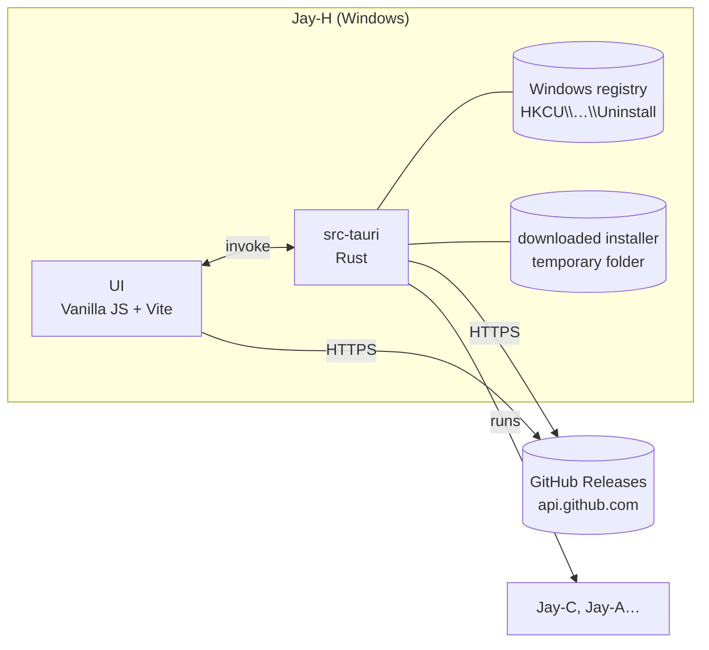

# Jay-H — Architecture

[Português](ARQUITETURA.md) · **English**

The hub of the Jay line: one app that gathers every Jay product (today **Jay-C**, **Jay-A**, **Jay-E**, **Jay-S** and Jay-H itself), shows the installed and the latest version of each one, and installs, updates and opens them. Windows first, like the others.

Written on 2026-11-06, starting from Jay-A 0.1.0 and Jay-C 0.4.0. License: **MIT**, like the whole line.

## 1. Overview

- In a browser (`npm run web`), the page can't read the registry: the card says "Only in the app".
- The **catalog** (`frontend/src/core/products.json`) lists each product: id, name, GitHub repository and executable name. The page and Rust read the same file; the translated description lives in `core/products.js`. A new product in the line = one entry in both.
- **Installed version:** Tauri's NSIS installer (`currentUser` mode) writes `HKCU\Software\Microsoft\Windows\CurrentVersion\Uninstall\<Product>` with `DisplayVersion` and `InstallLocation`. Measured: the installed Jay-C 0.2.4 shows up there.
- **Latest version:** the repository's `latest` release (`/repos/<repo>/releases/latest`). The installer is the `*_x64-setup.exe` asset, and GitHub gives its SHA-256 (`digest`). Jay-A has no release yet: the card says so.
- **Install and update** (`src-tauri/src/products.rs`): Rust fetches the release again (it doesn't trust the page), downloads the installer into a new temporary folder, checks its size and SHA-256, runs the installer with its own window (the person finishes there), waits and deletes the folder. One at a time. Jay-C's installer already updates over an older version (its own NSIS template).
- **Open:** runs `<InstallLocation>\<exe>`.
- **Jay-H itself** is in the catalog. Its "installed" version is the running one (`__APP_VERSION__`), and it has no "Open". To update itself, Rust downloads and checks the installer as for the others, opens the installer and closes Jay-H, because the installer needs to replace the `jay-h.exe` in use. That installer's temporary folder is left for Windows' cleanup.
- **Public repository:** GitHub's public API answers 404 for a private repository, so every product in the catalog needs a public repository. `TyxMatty/Jay-H` became public on 2026-11-06.
- **CI** (`.github/workflows/`, like Jay-C): `ci.yml` runs `npm test` (Ubuntu) and `cargo test` (Windows) on every push to main and on pull requests. `installer.yml` builds the installer on a `v*` tag (or by hand from the Actions tab), checks that the tag is the version in `tauri.conf.json` and keeps the `.exe` as an artifact. Publishing the release stays manual: upload the artifact's `.exe` to a release with the same tag.
- **New version:** bump the version in `tauri.conf.json`, `frontend/package.json` and `Cargo.toml`; commit; push a `vX.Y.Z` tag; wait for `installer.yml`; publish the artifact's `.exe` in a release with the same tag (`gh release create vX.Y.Z --verify-tag <exe>`). Jay-H's card then offers the update.

## 2. Technical decisions

| Topic | Choice | Why |
|---|---|---|
| Shell and UI | **Tauri v2 + Vanilla JS + Vite**, like Jay-C and Jay-A | Same stack, same look. Copied from Jay-A: `styles/theme.css` (Calm/Neon/Soft), the start of `app.css`, `ui/dom.js`, `ui/theme.js`, `core/i18n.js`, `core/style.js`, the Inter font and the wolf. |
| Icons | Jay-C's, like Jay-A | Changing them later is one `npx tauri icon <png>`. |
| Tray | **No** | The hub runs nothing in the background: closing the window closes the app. |
| Window icon | The wolf in the style's colors, like Jay-C (`ui/window-icon.js` + `src-tauri/src/taskbar_icon.rs`) | Tauri's `setIcon` only changes the small icon; the taskbar's needs `ICON_BIG` and, in the installed app, its own AppUserModelID. Measured: both icons change to each style's color. |
| Browser menu and shortcuts | Off in release, straight in WebView2 (`main.rs`: default menus and `AreBrowserAcceleratorKeysEnabled`) | It's an app, not a browser: no "Reload", F5, Ctrl+P, Ctrl+F, F12. Tauri's config has no such option. In dev they stay on. Measured: F5 sent to the WebView reloads dev and not release; right-click opens a menu in dev and not in release. |
| Single instance | `tauri-plugin-single-instance` | Opening it again shows the window that is already open. |
| Releases | GitHub's public API, no token | 60 requests per hour per IP are plenty for a hub that checks on start and on request. |
| Download and run | In Rust | The page can't write files or run programs; Rust checks the SHA-256 before running. |
| Vite port | **5176** | Jay-C uses 5173, Jay-A 5175: the three run in dev at the same time. |
| Settings | `localStorage`, key `jayh.settings` | Only interface preferences (theme, style, language). |

Out of scope for now (the user chose the launcher only): a repository panel for developers (git status, pull, open in the editor).

## 3. Security

- It only runs installers whose address is `https://github.com/<product's repository>/releases/download/…` and whose size and SHA-256 match the release's. Without a `digest`, it doesn't download. Measured: the `JayC` repository was renamed to `Jay-C`, the API returned the new address and the check refused it until the catalog was fixed.
- The installer goes into a new temporary folder and is deleted afterwards.
- No URL from outside the catalog: the page only sends the product's `id`; Rust builds the URL.

## 4. Stages

| # | Stage | Ends with |
|---|---|---|
| 0 | Scaffold: window, styles, theme, language, single instance, catalog with the cards (name, description, repository link) | `npm run web` shows the cards in the 3 styles; `npm test` passes ✅ |
| 1 | Versions: installed (registry) and latest (GitHub); status "Not installed", "Up to date", "Update: x.y.z", "No release yet"; "Check again" button | Jay-C's card shows 0.2.4 → 0.4.0 ✅ (measured in the dev app) |
| 2 | Install, update and open: download with progress, SHA-256, run the installer, then read the version again; "Open" button | ✅ download and SHA-256 of Jay-C 0.4.0's real installer (`cargo test -- --ignored`), buttons and errors in the dev app. **Missing:** running the installer for real, on a Windows test account (not on the user's Jay-C) |
| 3 | Jay-H's own installer (NSIS, English and Portuguese) and Jay-H in its own catalog, to update itself | ✅ `npm run build` makes the installer; Jay-H's card shows the running version; release [v0.1.0](https://github.com/TyxMatty/Jay-H/releases/tag/v0.1.0) published with the CI's installer, and the hub finds it (0.1.0, SHA-256 checked, "Up to date"). The user installed it and updated it from its card on their PC (0.1.0 → 0.1.1 → 0.1.2) ✅ |
