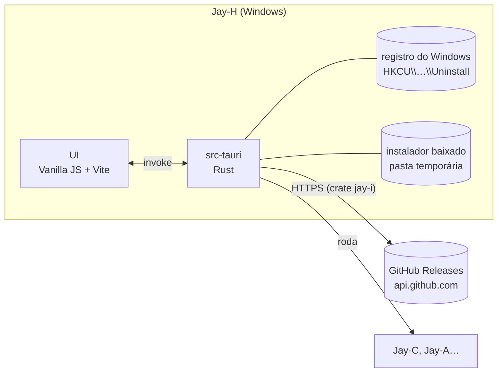

# Jay-H — Arquitetura

**Português** · [English](ARQUITETURA.en.md)

O hub da linha Jay: um app só que reúne todos os produtos Jay (hoje o **Jay-C**, o **Jay-A**, o **Jay-E**, o **Jay-S** e o próprio Jay-H), mostra a versão instalada e a mais nova de cada um, instala, atualiza e abre. Windows primeiro, como os outros.

Escrito em 2026-11-06, a partir do Jay-A 0.1.0 e do Jay-C 0.4.0. Licença: **MIT**, como a linha toda.

## 1. Visão geral

- No navegador (`npm run web`), a página não lê o registro nem pergunta ao GitHub: o card e a pílula dizem "Só no app".
- O **catálogo** (`frontend/src/core/products.json`) lista cada produto: id, nome, repositório no GitHub e nome do executável. A página e o Rust leem o mesmo arquivo; a descrição traduzida fica em `core/products.js`. Produto novo na linha = uma entrada nos dois.
- **Versão instalada:** o instalador NSIS do Tauri (modo `currentUser`) grava `HKCU\Software\Microsoft\Windows\CurrentVersion\Uninstall\<Produto>` com `DisplayVersion` e `InstallLocation`. Medido: o Jay-C 0.2.4 instalado aparece lá.
- **Versão mais nova:** a release `latest` do repositório (`/repos/<repo>/releases/latest`), pedida pelo Rust (comando `latest_release`), não pela página. O instalador é o asset `*_x64-setup.exe`, e o GitHub informa o SHA-256 dele (`digest`); o card só oferece "Instalar" se o Rust aceitaria esse instalador. Jay-A ainda não tem release: o card diz isso.
- **A crate `jay-i`:** buscar a release, escolher e conferir o instalador, baixar com SHA-256 e ler o registro vêm da crate compartilhada da linha ([Jay-I](https://github.com/TyxMatty/Jay-I)), fixada por commit. O `products.rs` ficou com o que é só do hub: o catálogo, um de cada vez, o progresso para a página, abrir o app e a autoatualização.
- **Instalar e atualizar** (`src-tauri/src/products.rs`): o Rust busca a release de novo (não confia na página), baixa o instalador numa pasta temporária nova, confere tamanho e SHA-256, roda, espera e apaga a pasta. Um de cada vez. Produto **não instalado**: o instalador abre com a janela dele (o setup do Jay-I mostra a tela de confirmação; releases antigas ainda trazem o NSIS cru, com a janela própria; a pessoa termina lá). Produto **já instalado**: atualização passiva (`/P /UPDATE`), só a barra de progresso, sem perguntas, e o instalador fecha sozinho. O cartão mostra "Pronto." com o código 0 e "O instalador fechou sem terminar (código N)." com os outros (1 = cancelado, no setup e no NSIS; 2 = o setup não conseguiu rodar o instalador).
- **Abrir:** roda `<InstallLocation>\<exe>`.
- **O próprio Jay-H** está no catálogo. A versão "instalada" dele é a que está rodando (`__APP_VERSION__`), e ele não tem "Abrir". Para se atualizar, o Rust baixa e confere o instalador como nos outros, abre o instalador em modo passivo com `/R` (`/P /UPDATE /R`: ele reabre o Jay-H no fim) e fecha o Jay-H, porque o instalador precisa trocar o `jay-h.exe` em uso. A pasta temporária desse instalador fica para a limpeza do Windows.
- **Repositório público:** a API pública do GitHub responde 404 para um repositório privado, então todo produto do catálogo precisa de repositório público. O `TyxMatty/Jay-H` ficou público em 2026-11-06.
- **CI** (`.github/workflows/`, como no Jay-C): `ci.yml` roda `npm test` (Ubuntu) e `cargo test` (Windows) a cada push no main e em pull requests. `installer.yml` gera o instalador numa tag `v*` (ou à mão pela aba Actions), confere se a tag é a versão do `tauri.conf.json`, monta o setup do Jay-I em volta do NSIS e guarda só o setup como artefato (seção 3, "O setup do Jay-I"). Publicar a release continua manual: subir o `.exe` do artefato numa release com a mesma tag.
- **Nova versão:** subir a versão no `tauri.conf.json`, no `frontend/package.json` e no `Cargo.toml`; commit; tag `vX.Y.Z` com push; esperar o `installer.yml`; publicar o `.exe` do artefato numa release com a mesma tag (`gh release create vX.Y.Z --verify-tag <exe>`). O card do Jay-H passa a oferecer a atualização.

## 2. Decisões técnicas

| Tema | Escolha | Motivo |
|---|---|---|
| Shell e UI | **Tauri v2 + Vanilla JS + Vite**, como Jay-C e Jay-A | Mesmo stack, mesma estética. Copiados do Jay-A: `styles/theme.css` (Calmo/Neon/Suave), o começo do `app.css`, `ui/dom.js`, `ui/theme.js`, `core/i18n.js`, `core/style.js`, a fonte Inter e o lobo. |
| Ícones | Os do Jay-C, como o Jay-A | Trocar depois é um `npx tauri icon <png>`. |
| Bandeja | **Não** | O hub não roda nada em segundo plano: fechar a janela fecha o app. |
| Ícone da janela | O lobo nas cores do estilo, como no Jay-C (`ui/window-icon.js` + `src-tauri/src/taskbar_icon.rs`) | O `setIcon` do Tauri só troca o ícone pequeno; o da barra de tarefas precisa do `ICON_BIG` e, no app instalado, de um AppUserModelID próprio. Medido: os dois ícones mudam para a cor de cada estilo. |
| Menu e atalhos do navegador | Desligados no release, direto no WebView2 (`main.rs`: menus padrão e `AreBrowserAcceleratorKeysEnabled`) | É um app, não um navegador: nada de "Recarregar", F5, Ctrl+P, Ctrl+F, F12. O config do Tauri não tem essa opção. No dev ficam ligados. Medido: F5 enviado ao WebView recarrega o dev e não o release; o clique direito abre menu no dev e não no release. |
| Instância única | `tauri-plugin-single-instance` | Abrir de novo mostra a janela que já está aberta. |
| Releases | API pública do GitHub, sem token | 60 pedidos por hora por IP bastam para um hub que consulta ao abrir e quando pedem. |
| Download e execução | No Rust | A página não pode gravar arquivo nem rodar programa; o Rust confere o SHA-256 antes de rodar. |
| Porta do Vite | **5176** | Jay-C usa 5173, Jay-A 5175: os três rodam em dev ao mesmo tempo. |
| Configurações | `localStorage`, chave `jayh.settings` | Só preferências da interface (tema, estilo, idioma). |

Fora do escopo por enquanto (o usuário escolheu só o launcher): painel de repositórios para quem desenvolve (status git, pull, abrir no editor).

## 3. Segurança

- Só roda instaladores cujo endereço é `https://github.com/<repositório do produto>/releases/download/…` e com tamanho e SHA-256 iguais aos da release. Sem `digest`, não baixa. Medido: o repositório `JayC` foi renomeado para `Jay-C`, a API devolveu o endereço novo e a checagem recusou até o catálogo ser corrigido.
- O instalador vai para uma pasta temporária nova e é apagado depois.
- Nada de URL vinda de fora do catálogo: a página manda só o `id` do produto; o Rust monta a URL.

### O setup do Jay-I (0.1.6)

Três mudanças. **(a)** O `products.rs` deixa de ter a própria cópia da busca da release, da escolha e conferência do instalador, do download com SHA-256 e da leitura do registro: usa a crate `jay-i` (`latest`, `pick_installer`, `download`, `run`, `installed`), do repositório `TyxMatty/Jay-I` no commit `f4f9ef07c0cf49abd1f53d3caa00c69e5aa1c90a`. As dependências diretas `sha2`, `ureq` e `winreg` saíram (agora vêm só pela crate). **(b)** A página não fala mais com o GitHub: a versão mais nova vem do comando `latest_release`, e o `connect-src` da CSP perdeu `https://api.github.com`. **(c)** O arquivo da release passa a ser o setup do Jay-I: o `installer.yml` faz o NSIS do Tauri como antes, baixa o Jay-I no mesmo commit, roda o `scripts/build-setup.ps1` dele com o NSIS dentro (nome Jay-H, a versão do `tauri.conf.json`, `jay-h.exe`, o `icon.ico` e o `128x128@2x.png` do app) e só a pasta `setup-out/` sobe como artefato. O NSIS cru tem o mesmo nome e fica em `bundle/nsis`, de onde nada sobe.

Como cada instalador roda (`jay_i::run`): produto não instalado, `Mode::Interactive` (a janela do instalador; a pessoa confirma lá); produto já instalado, `Mode::Update { relaunch: false }` (`/P /UPDATE`: só o progresso, e o hub espera o código de saída); o próprio Jay-H, `Mode::Update { relaunch: true }` (`/P /UPDATE /R`), lançado e o Jay-H sai, como antes.

Pelos 10 pontos:

1. **Superfície de ataque.** Um comando novo, `latest_release(id)`, que só aceita um `id` do catálogo. O resto encolheu: a página não faz mais nenhuma requisição de rede. Novo também: a atualização passiva de um app já instalado roda sem pedir confirmação na janela do instalador (o clique em "Atualizar" no card é a confirmação). Na CI: o checkout de outro repositório e um `cargo build` dele. *Conferido:* os comandos no `main.rs` e nos testes. *Não conferido:* um instalador rodado de verdade pelo hub depois da mudança.
2. **Controle de acesso / IDOR.** Igual a antes: a página manda só o `id`; repositório, endereço, nome do produto no registro e executável vêm do `products.json` embutido no binário. Um `id` fora do catálogo dá erro (`catalog_is_valid`).
3. **Permissões de dados.** O hub não tem dados da pessoa além das preferências da interface. O instalador vai para uma pasta nova em `%TEMP%` (`jay-i-<pid>-<tempo>-<n>`); se a conferência falha, ela é apagada; depois de um instalador de outro app, também; a do próprio Jay-H fica para a limpeza do Windows (ele roda de lá).
4. **Entrada não confiável para operação sensível.** A resposta do GitHub é JSON com teto de 1 MB; o instalador só roda se o endereço é deste repositório, o nome é simples, o tamanho bate e o SHA-256 bate com o `digest` (tudo na crate, com os testes dela). A versão vinda do GitHub chega à página só como texto (`textContent`). O botão "Instalar" agora só aparece se o Rust aceitaria o instalador (`latest_of_offers_install_only_for_a_checkable_installer`); antes bastava um arquivo com o nome certo. **Limite:** os instaladores **não são assinados**, e o SHA-256 vem do próprio GitHub (o `digest` que ele calcula para cada arquivo), não fixado no código: quem controla a conta do projeto no GitHub controla o que roda.
5. **Credenciais expostas.** Nenhuma: a API do GitHub é chamada sem token; o checkout do Jay-I usa `persist-credentials: false` e o workflow segue com `permissions: contents: read`.
6. **Autenticação.** Não se aplica (repositórios públicos, sem conta).
7. **Abuso de recursos e corridas.** Um instalador por vez (`Busy`, como antes; "Atualizar tudo" vai um a um, o Jay-H por último). Download com teto de 200 MB e tempo limite em cada etapa da rede (na crate; antes não havia tempo limite). Uma consulta por produto ao abrir e a cada "Verificar de novo", como antes. **Limite:** na atualização passiva, se o app estiver aberto, o instalador NSIS do Tauri o fecha sem perguntar; não medido aqui.
8. **Cadeia de dependências.** Uma dependência git, `jay-i`, fixada pelo commit (`rev`), não por branch; ela traz `ureq` 3, `sha2` e `winreg` 0.56 (no `Cargo.lock`). No workflow, o checkout do `TyxMatty/Jay-I` também pelo SHA completo, e todas as Actions passaram a ser fixadas por SHA de 40 dígitos (antes, por tag `@v7`). O `installer.test.js` exige os SHAs de 40 dígitos e o mesmo commit no `Cargo.toml` e no workflow. Subir o Jay-I é trocar os dois juntos. `cargo audit` no `Cargo.lock` novo: nenhuma vulnerabilidade, 5 avisos (crates do build de Linux do Tauri: `glib`, `proc-macro-error`, `zbus_names`, `zvariant`, `zvariant_derive`).
9. **Rede e exposição.** As mesmas requisições HTTPS de antes (`api.github.com/repos/<repo>/releases/latest` por produto e o download em `github.com/<repo>/releases/download/`), agora todas do Rust, com *user agent* `Jay-H/<versão>` (diz a versão do hub ao GitHub). A CSP da página ficou `connect-src 'self' ipc: http://ipc.localhost`, travada pelo `installer.test.js`.
10. **Testes adversariais e critérios de release.** Rust (`products.rs`): `latest_of_offers_install_only_for_a_checkable_installer` (sem digest, endereço de outro repositório, sem arquivos: nada de "Instalar"), `mode_depends_on_install_state` (os argumentos de cada caso), `catalog_is_valid`; o teste ignorado `downloads_and_checks_jay_c` baixa o instalador real do Jay-C e confere sem rodar. Os testes de endereço, digest, nome, tamanho e pasta temporária saíram daqui e estão na crate. JS: `installer.test.js` (instalação por usuário, CSP sem endereço externo, permissões, os SHAs e o artefato vindo de `setup-out/`, nunca de `bundle/nsis`). **Bloqueia a release:** esses testes falhando; o setup acima de 15 MB ou do mesmo tamanho do NSIS cru (o workflow falha).

**Medido (2026-11-10):** `npm test` 17 de 17; `cargo test` 4 passaram, 1 ignorado. `cargo clippy --all-targets -- -D warnings` acusa 2 erros, os dois `chunks_exact_to_as_chunks` no `taskbar_icon.rs` (arquivo não mexido; lint de um clippy mais novo); sem esse lint, limpo. O passo do workflow rodado à mão no Windows PowerShell 5.1, com o Jay-I exportado no commit fixado e o NSIS 0.1.5 publicado como carga (1.939.970 bytes, SHA-256 igual ao `digest` do GitHub): `Jay-H_0.1.5_x64-setup.exe` com 5.167.616 bytes, abaixo dos 15 MB; as três checagens falham quando devem (arquivo de 16 MB, o NSIS cru no lugar do setup, pasta sem o NSIS). Nenhum setup nem instalador foi rodado. No app de dev, pela depuração remota: os cinco cards leram a versão mais nova pelo `latest_release` (Jay-C 0.2.4 → 0.5.2, Jay-A 0.1.0 → 0.3.3, Jay-E e Jay-H atualizados, Jay-S "Instalar"), a página só fez requisições a `ipc.localhost`, e o layout ficou igual no claro e no escuro. **Para quem for testar:** rejeitar o `fetch` do IPC não bloqueia um comando, porque o Tauri tenta de novo por `postMessage`; um `install_app` com `id` inexistente passou assim e parou no "unknown product", sem baixar nada. Para bloquear, devolva uma resposta falsa. *Não exercitado:* as Actions no GitHub (`checkout` do Jay-I, `upload-artifact`, `pwsh` do runner) e uma instalação ou atualização de verdade pelo hub (um processo iniciado deste ambiente de desenvolvimento grava num AppData isolado e deixaria atalhos quebrados).

## 4. Etapas

| # | Etapa | Termina com |
|---|---|---|
| 0 | Scaffold: janela, estilos, tema, idioma, instância única, catálogo com os cards (nome, descrição, link do repositório) | `npm run web` mostra os cards nos 3 estilos; `npm test` passa ✅ |
| 1 | Versões: instalada (registro) e mais nova (GitHub); status "Não instalado", "Atualizado", "Atualização: x.y.z", "Sem release ainda"; botão "Verificar de novo" | o card do Jay-C mostra 0.2.4 → 0.4.0 ✅ (medido no app de dev) |
| 2 | Instalar, atualizar e abrir: download com progresso, SHA-256, roda o instalador, depois relê a versão; botão "Abrir" | ✅ download e SHA-256 do instalador real do Jay-C 0.4.0 (`cargo test -- --ignored`), botões e erros no app de dev. **Falta:** rodar o instalador de verdade, numa conta de teste do Windows (não no Jay-C do usuário) |
| 3 | Instalador do próprio Jay-H (NSIS, inglês e português) e o Jay-H no próprio catálogo, para se atualizar | ✅ `npm run build` gera o instalador; o card do Jay-H mostra a versão em uso; release [v0.1.0](https://github.com/TyxMatty/Jay-H/releases/tag/v0.1.0) publicada com o instalador da CI, e o hub a acha (0.1.0, SHA-256 conferido, "Atualizado"). O usuário instalou e se atualizou pelo card no PC dele (0.1.0 → 0.1.1 → 0.1.2) ✅ |
