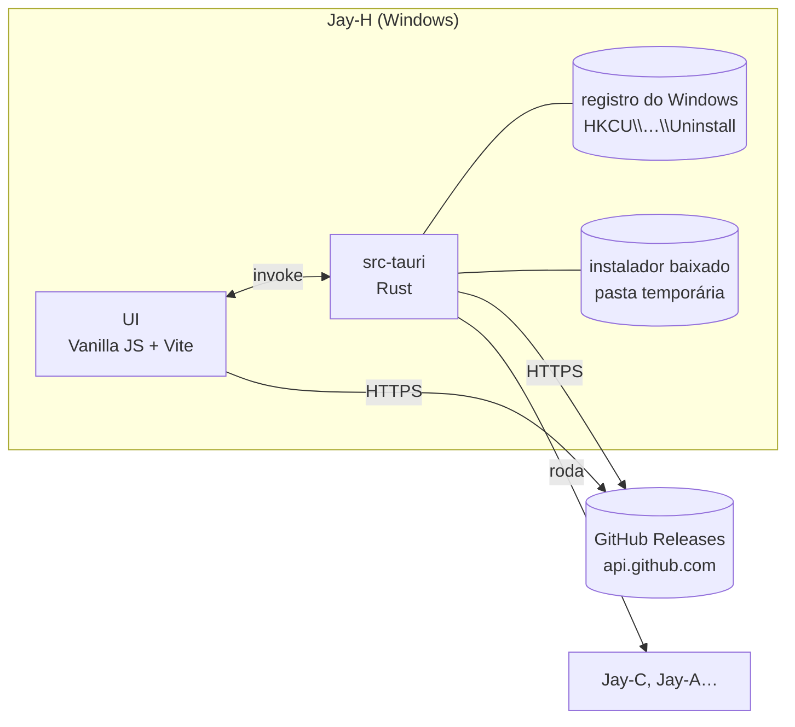

# Jay-H — Arquitetura

O hub da linha Jay: um app só que reúne todos os produtos Jay (hoje o **Jay-C**, o **Jay-A**, o **Jay-E** e o próprio Jay-H), mostra a versão instalada e a mais nova de cada um, instala, atualiza e abre. Windows primeiro, como os outros.

Escrito em 2026-11-06, a partir do Jay-A 0.1.0 e do Jay-C 0.4.0. Licença: **MIT**, como a linha toda.

## 1. Visão geral

- No navegador (`npm run web`), a página não lê o registro: o card diz "Só no app".
- O **catálogo** (`frontend/src/core/products.json`) lista cada produto: id, nome, repositório no GitHub e nome do executável. A página e o Rust leem o mesmo arquivo; a descrição traduzida fica em `core/products.js`. Produto novo na linha = uma entrada nos dois.
- **Versão instalada:** o instalador NSIS do Tauri (modo `currentUser`) grava `HKCU\Software\Microsoft\Windows\CurrentVersion\Uninstall\<Produto>` com `DisplayVersion` e `InstallLocation`. Medido: o Jay-C 0.2.4 instalado aparece lá.
- **Versão mais nova:** a release `latest` do repositório (`/repos/<repo>/releases/latest`). O instalador é o asset `*_x64-setup.exe`, e o GitHub informa o SHA-256 dele (`digest`). Jay-A ainda não tem release: o card diz isso.
- **Instalar e atualizar** (`src-tauri/src/products.rs`): o Rust busca a release de novo (não confia na página), baixa o instalador numa pasta temporária nova, confere tamanho e SHA-256, roda o instalador com a janela dele (a pessoa termina lá), espera e apaga a pasta. Um de cada vez. O instalador do Jay-C já atualiza por cima de uma versão mais velha (template NSIS próprio dele).
- **Abrir:** roda `<InstallLocation>\<exe>`.
- **O próprio Jay-H** está no catálogo. A versão "instalada" dele é a que está rodando (`__APP_VERSION__`), e ele não tem "Abrir". Para se atualizar, o Rust baixa e confere o instalador como nos outros, abre o instalador e fecha o Jay-H, porque o instalador precisa trocar o `jay-h.exe` em uso. A pasta temporária desse instalador fica para a limpeza do Windows.
- **Repositório público:** a API pública do GitHub responde 404 para um repositório privado, então todo produto do catálogo precisa de repositório público. O `TyxMatty/Jay-H` ficou público em 2026-11-06.
- **CI** (`.github/workflows/`, como no Jay-C): `ci.yml` roda `npm test` (Ubuntu) e `cargo test` (Windows) a cada push no main e em pull requests. `installer.yml` gera o instalador numa tag `v*` (ou à mão pela aba Actions), confere se a tag é a versão do `tauri.conf.json` e guarda o `.exe` como artefato. Publicar a release continua manual: subir o `.exe` do artefato numa release com a mesma tag.

## 2. Decisões técnicas

| Tema | Escolha | Motivo |
|---|---|---|
| Shell e UI | **Tauri v2 + Vanilla JS + Vite**, como Jay-C e Jay-A | Mesmo stack, mesma estética. Copiados do Jay-A: `styles/theme.css` (Calmo/Neon/Suave), o começo do `app.css`, `ui/dom.js`, `ui/tabs.js`, `ui/theme.js`, `core/i18n.js`, `core/style.js`, a fonte Inter e o lobo. |
| Ícones | Os do Jay-C, como o Jay-A | Trocar depois é um `npx tauri icon <png>`. |
| Bandeja | **Não** | O hub não roda nada em segundo plano: fechar a janela fecha o app. |
| Instância única | `tauri-plugin-single-instance` | Abrir de novo mostra a janela que já está aberta. |
| Releases | API pública do GitHub, sem token | 60 pedidos por hora por IP bastam para um hub que consulta ao abrir e quando pedem. |
| Download e execução | No Rust | A página não pode gravar arquivo nem rodar programa; o Rust confere o SHA-256 antes de rodar. |
| Porta do Vite | **5176** | Jay-C usa 5173, Jay-A 5175: os três rodam em dev ao mesmo tempo. |
| Configurações | `localStorage`, chave `jayh.settings` | Só preferências da interface (tema, estilo, idioma). |

Fora do escopo por enquanto (o usuário escolheu só o launcher): painel de repositórios para quem desenvolve (status git, pull, abrir no editor).

## 3. Segurança

- Só roda instaladores cujo endereço é `https://github.com/<repositório do produto>/releases/download/…` e com tamanho e SHA-256 iguais aos da release. Sem `digest`, não baixa. Medido: o repositório `JayC` foi renomeado para `Jay-C`, a API devolveu o endereço novo e a checagem recusou até o catálogo ser corrigido.
- O instalador vai para uma pasta temporária nova e é apagado depois.
- Nada de URL vinda de fora do catálogo: a página manda só o `id` do produto; o Rust monta a URL.

## 4. Etapas

| # | Etapa | Termina com |
|---|---|---|
| 0 | Scaffold: janela, estilos, tema, idioma, instância única, catálogo com os cards (nome, descrição, link do repositório) | `npm run web` mostra os cards nos 3 estilos; `npm test` passa ✅ |
| 1 | Versões: instalada (registro) e mais nova (GitHub); status "Não instalado", "Atualizado", "Atualização: x.y.z", "Sem release ainda"; botão "Verificar de novo" | o card do Jay-C mostra 0.2.4 → 0.4.0 ✅ (medido no app de dev) |
| 2 | Instalar, atualizar e abrir: download com progresso, SHA-256, roda o instalador, depois relê a versão; botão "Abrir" | ✅ download e SHA-256 do instalador real do Jay-C 0.4.0 (`cargo test -- --ignored`), botões e erros no app de dev. **Falta:** rodar o instalador de verdade, numa conta de teste do Windows (não no Jay-C do usuário) |
| 3 | Instalador do próprio Jay-H (NSIS, inglês e português) e o Jay-H no próprio catálogo, para se atualizar | ✅ `npm run build` gera o instalador; o card do Jay-H mostra a versão em uso. **Falta:** publicar uma release (o repositório precisa ser público) e testar instalar e se atualizar numa conta de teste do Windows |
